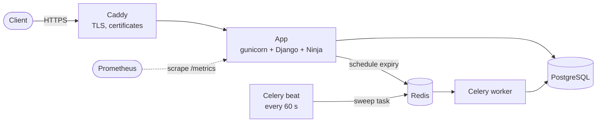
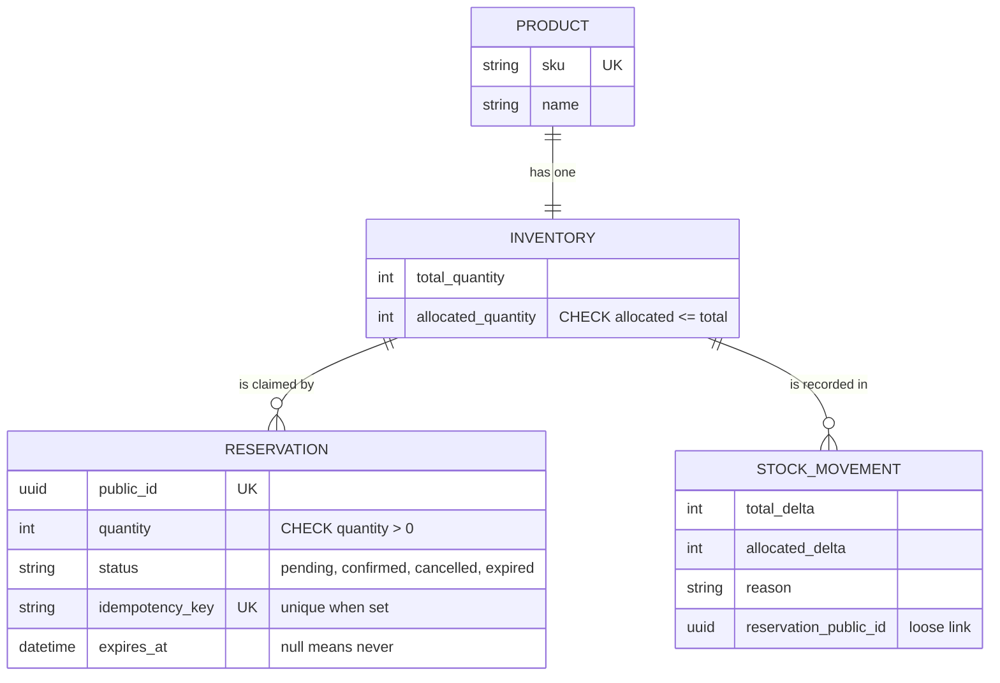
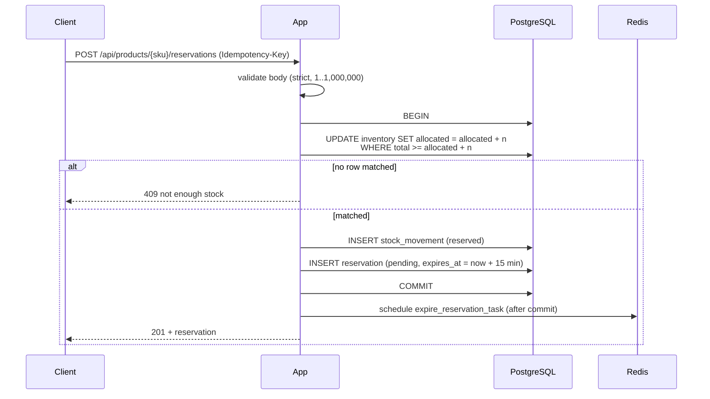
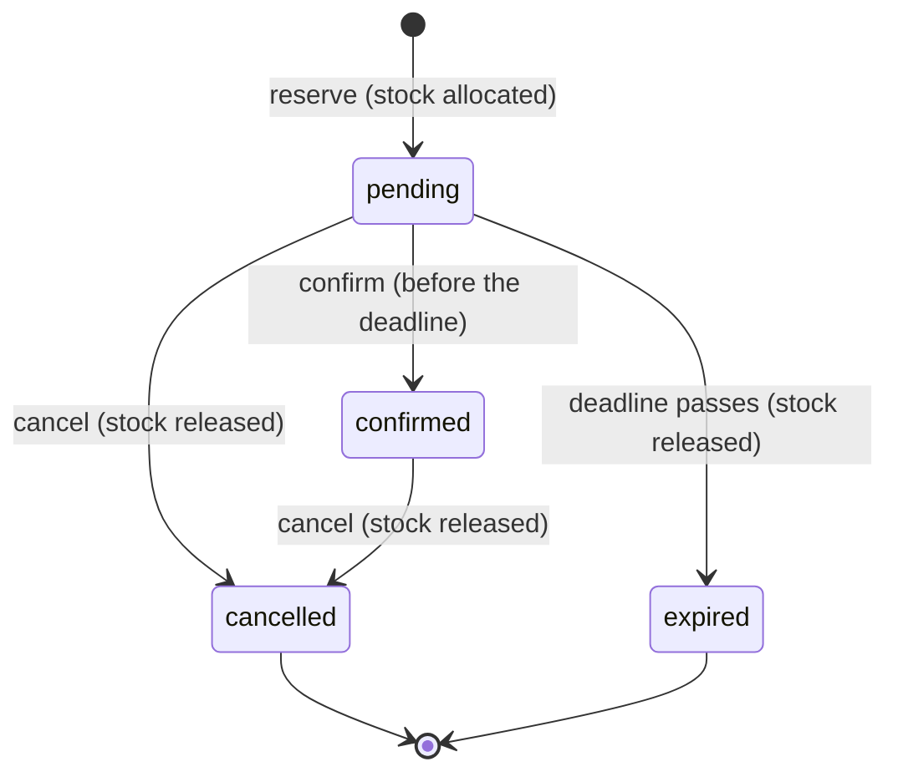

# Architecture

Mwenendo Core is an inventory allocation engine. Clients reserve units of a
product, and the system guarantees it never promises more stock than exists, even
when many requests arrive at once. This document describes how it is put together
and why. Each decision has its own record in [docs/adr/](adr/).

## The system at a glance

| Part | Technology | Job |
|---|---|---|
| API | Django 5.2, Django Ninja | Typed endpoints, validation, generated docs at `/api/docs` |
| Database | PostgreSQL 17 | The source of truth, and the lock that serialises competing requests |
| Queue | Redis, Celery | Delayed expiry tasks and the periodic sweep |
| Server | gunicorn (4 workers), WhiteNoise | Production serving, and static files for the admin |
| Proxy | Caddy (production only) | HTTPS, and hides `/metrics` |
| Monitoring | JSON logs, Prometheus `/metrics`, `/health/` and `/health/ready/` | Seeing what the system does |

The code is split into three Django apps (ADR-0002): `core` (shared pieces: health,
logging, metrics middleware), `inventory` (products, stock, the ledger) and
`reservations` (the reservation lifecycle). `reservations` calls `inventory`'s
services, never the other way, and `core` depends on neither.

## The data

Stock is two counters on one row (ADR-0003). They are fast to read and easy to
guard. An append-only ledger (`StockMovement`, ADR-0011) records every change in
the same transaction, so the counters can be checked against their own history with
`manage.py reconcile_stock`.

## What happens when someone reserves stock

The `UPDATE` is the heart of it: the stock check and the stock write are one
statement, so two requests cannot both claim the last unit (ADR-0008).

## The reservation lifecycle

The allowed moves live in one table, `ALLOWED_TRANSITIONS` (ADR-0009). Each move is a
conditional `UPDATE ... WHERE status IN (...)`, so of two competing requests only one
matches and stock is released at most once.

## Guarantees and where they come from

| Guarantee | Mechanism | Decision | Proved by |
|---|---|---|---|
| Never allocate more than the total | `UPDATE ... WHERE total >= allocated + n`, plus a `CHECK` constraint as the backstop | ADR-0004, ADR-0008 | 30 threads reserving a stock of 10: exactly 10 succeed |
| A retried request does not hold stock twice | Idempotency key under a unique constraint; the loser's transaction rolls back | ADR-0010 | 10 simultaneous requests with one key: one reservation |
| Stock is released exactly once | The status change is claimed first, and only the winner releases | ADR-0009, ADR-0012 | 10 simultaneous cancels, and 10 simultaneous expiries |
| Counters and reservations cannot drift | Same transaction for the counter and the reservation row | ADR-0007 | A forced insert failure restores the counter |
| Every stock change is explainable | Append-only ledger written in the same transaction | ADR-0011 | `reconcile_stock` after every concurrency test and benchmark |
| Overdue reservations free their stock | A delayed task per reservation, and a sweep every minute as the safety net | ADR-0012 | Tests, and a manual run against a real worker |
| A broker outage does not break reservations | Scheduling failures are logged and the sweep catches up | ADR-0012 | A test, and a manual run with Redis stopped |

## Observability

- **Logs:** one JSON object per line, with a request id that also appears in the
  response header and in every log line written during the request (ADR-0014). The
  business events (`reservation.created`, `.expired` and so on) are logged after the
  transaction commits.
- **Metrics:** `/metrics` has request counts and latency by route pattern, refused
  allocations, and reservations and stock read from the database at scrape time
  (ADR-0015).
- **Health:** `/health/` says the process is alive, and `/health/ready/` says whether
  it can take traffic. Only the database decides readiness, because the system still
  works without Redis.

## Testing

About 230 automated tests run against a real PostgreSQL, in CI on every push. The
concurrency tests use real threads and real commits, not mocks, and each is paired
with a deliberately naive version that fails in the same harness, so the tests are
shown to be able to catch the bug. Load tests with Locust (`loadtests/`) check
correctness as well as speed, and the results are in [BENCHMARKS.md](BENCHMARKS.md).

## Known gaps

These are listed so nobody has to find them by surprise.

- **There is no authentication.** Anyone who can reach the API can reserve, confirm
  and cancel. Idempotency keys are therefore global. The admin is protected, the API
  is not.
- **One machine.** The deployment is a single VM (ADR-0017), with no redundancy.
- **Worker-side metrics are not exposed.** The database gauges cover the worker's
  effect, but not task durations or retries.
- **Request ids do not reach Celery tasks.**
- **Retry and late-acknowledgement settings are configured, but no test or manual run
  has shown a retry happening.**
- **The ledger is append-only by convention**, not enforced by the database.
- **Reconciliation scans every inventory.** Fine at this size, not for millions of rows.
- **The benchmark against gunicorn has not been run yet**, so there are no numbers for
  a production-style server or for what persistent connections gain.
- **Mutation checks have not been done systematically.** Breaking the code on purpose
  to confirm a test fails would show which tests really protect something. The
  concurrency tests are the exception in spirit: each is paired with a naive version
  that is shown to fail in the same harness.

## Decision records

| ADR | Decision |
|---|---|
| [0001](adr/0001-use-postgresql.md) | Use PostgreSQL |
| [0002](adr/0002-split-into-core-inventory-reservations-apps.md) | Split into `core`, `inventory` and `reservations` |
| [0003](adr/0003-represent-stock-as-counters.md) | Represent stock as counters |
| [0004](adr/0004-enforce-invariant-in-database-and-code.md) | Enforce the invariant in the database and in code |
| [0005](adr/0005-use-django-ninja-for-the-api.md) | Use Django Ninja |
| [0006](adr/0006-shape-of-the-stock-api.md) | The shape of the stock API |
| [0007](adr/0007-reservations-hold-stock-in-one-transaction.md) | Reservations hold stock in one transaction |
| [0008](adr/0008-conditional-update-for-concurrent-allocation.md) | Guard concurrent allocation with a conditional UPDATE |
| [0009](adr/0009-reservation-state-transitions.md) | State transitions as a table, applied by a conditional UPDATE |
| [0010](adr/0010-idempotency-keys-on-reservation-creation.md) | Idempotency keys on reservation creation |
| [0011](adr/0011-append-only-stock-ledger.md) | An append-only stock ledger |
| [0012](adr/0012-reservation-expiry.md) | Expiry with a delayed task and a sweep |
| [0013](adr/0013-run-in-containers-behind-gunicorn.md) | Containers behind gunicorn |
| [0014](adr/0014-structured-logging-and-readiness.md) | Structured logging and readiness |
| [0015](adr/0015-prometheus-metrics-endpoint.md) | Prometheus metrics |
| [0016](adr/0016-persistent-database-connections.md) | Persistent database connections |
| [0017](adr/0017-deploy-to-a-single-vm-with-compose.md) | Deploy to a single VM with Docker Compose |
